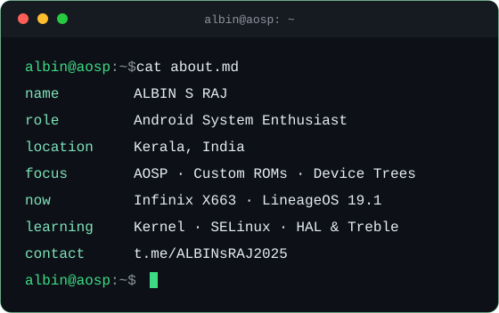
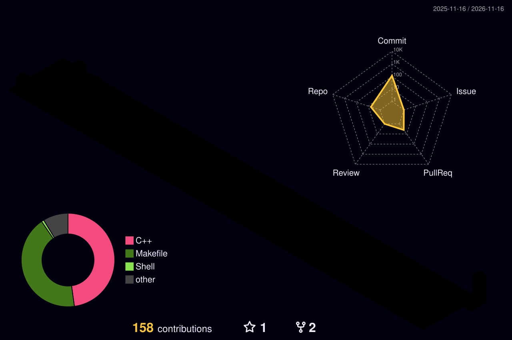

  
  

  
  
  
  

<h2>🤖 About Me</h2>

  

<h2>🚀 Featured Projects</h2>

<table>
  <tr>
    <td>
      <h4>📱 <a href="https://github.com/ALBINsRAJ2025/android_device_infinix_X663">android_device_infinix_X663</a></h4>
      Device tree for the Infinix Note 11 (X663) on Android 12 / LineageOS 19.1 
      
      
    </td>
  </tr>
  <tr>
    <td>
      <h4>🐧 <a href="https://github.com/ALBINsRAJ2025/android_kernel_infinix_X663">android_kernel_infinix_X663</a></h4>
      Prebuilt kernel, DTB, DTBO and defconfig for the Infinix X663 
      
    </td>
  </tr>
  <tr>
    <td>
      <h4>🔧 <a href="https://github.com/ALBINsRAJ2025/android_vendor_infinix_X663">android_vendor_infinix_X663</a></h4>
      Vendor makefiles and blob inventory for the Infinix X663 (stock blobs excluded) 
      
      
    </td>
  </tr>
  <tr>
    <td>
      <h4>🛟 <a href="https://github.com/ALBINsRAJ2025/recovery_device_infinix_Infinix-X663">recovery_device_infinix_Infinix-X663</a></h4>
      Recovery device tree for the Infinix X663 
      
      
    </td>
  </tr>
</table>

<h2>🧰 Tech Stack &amp; Tools</h2>

  

  
  
  
  
  
  

<h2>📊 GitHub Stats</h2>

  
  

  
  

<h2>📈 Contribution Activity</h2>

<picture>
  <source media="(prefers-color-scheme: dark)" srcset="https://raw.githubusercontent.com/ALBINsRAJ2025/ALBINsRAJ2025/main/profile-3d-contrib/profile-night-rainbow.svg" />
  <source media="(prefers-color-scheme: light)" srcset="https://raw.githubusercontent.com/ALBINsRAJ2025/ALBINsRAJ2025/main/profile-3d-contrib/profile-green-animate.svg" />
  
</picture>

<picture>
  <source media="(prefers-color-scheme: dark)" srcset="https://raw.githubusercontent.com/ALBINsRAJ2025/ALBINsRAJ2025/output/github-snake-dark.svg" />
  <source media="(prefers-color-scheme: light)" srcset="https://raw.githubusercontent.com/ALBINsRAJ2025/ALBINsRAJ2025/output/github-snake.svg" />
  
</picture>

 

<h3>🤝 Open to collaborating on ROMs, device trees &amp; Android system projects — ping me on <a href="https://t.me/ALBINsRAJ2025">Telegram</a>!</h3>

