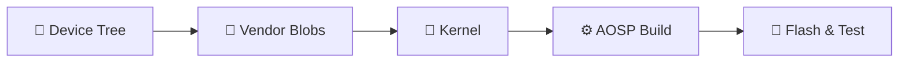

<!-- ═══════════════════════ HEADER ═══════════════════════ -->
<div align="center">


<p>
  
  <a href="https://github.com/ALBINsRAJ2025?tab=followers">
    
  </a>
</p>

<p>
  <a href="https://t.me/ALBINsRAJ2025"></a>
  <a href="https://www.instagram.com/albin_s_raj/"></a>
  <a href="https://www.facebook.com/albin.s.raj.2025"></a>
  <a href="mailto:albinsraj2025@gmail.com"></a>
</p>


</div>

<!-- ═══════════════════════ ABOUT ═══════════════════════ -->
<h2 align="center">🤖 About Me</h2>

```kotlin
object AlbinSRaj {
    val role      = "Android System Enthusiast"
    val location  = "Kerala, India 🇮🇳"
    val focus     = listOf("AOSP", "Custom ROM Development", "Device Trees", "Android System Internals")
    val working   = "🛠️ Android, AOSP & custom ROM development"
    val learning  = listOf("Kernel internals", "SELinux policies", "Soong / Blueprint", "HAL & Treble")
    val funFact   = "I read build logs for fun 😄"
    val reachMe   = "Telegram → @ALBINsRAJ2025"
}
```

<h3 align="center">⚙️ My ROM Development Workflow</h3>



<!-- ═══════════════════════ TECH STACK ═══════════════════════ -->
<h2 align="center">🧰 Tech Stack & Tools</h2>

<p align="center">
  
</p>

<p align="center">
  
  
  
  
  
  
</p>

<!-- ═══════════════════════ GITHUB STATS ═══════════════════════ -->
<h2 align="center">📊 GitHub Stats</h2>

<p align="center">
  
  
</p>

<p align="center">
  
</p>

<p align="center">
  
</p>

<!-- ═══════════════════════ ACTIVITY ═══════════════════════ -->
<h2 align="center">📈 Contribution Activity</h2>

<p align="center">
  
</p>

<!-- Snake animation: needs the GitHub Action in .github/workflows/snake.yml (run it once) -->
<p align="center">
  <picture>
    <source media="(prefers-color-scheme: dark)" srcset="https://raw.githubusercontent.com/ALBINsRAJ2025/ALBINsRAJ2025/output/github-snake-dark.svg" />
    <source media="(prefers-color-scheme: light)" srcset="https://raw.githubusercontent.com/ALBINsRAJ2025/ALBINsRAJ2025/output/github-snake.svg" />
    
  </picture>
</p>

<!-- ═══════════════════════ FEATURED PROJECTS (hidden until you add repos) ═══════════════════════
To show it: delete this comment wrapper, replace REPO_NAME with your repo names, add one <a> per repo.

<h2 align="center">🚀 Featured Projects</h2>

<p align="center">
  <a href="https://github.com/ALBINsRAJ2025/REPO_NAME">
    
  </a>
  <a href="https://github.com/ALBINsRAJ2025/REPO_NAME_2">
    
  </a>
</p>
═══════════════════════════════════════════════════════════════════════════════════════════ -->

<!-- ═══════════════════════ QUOTE + FOOTER ═══════════════════════ -->
<p align="center">
  
</p>

<h3 align="center">🤝 Open to collaborating on ROMs, device trees & Android system projects — ping me on <a href="https://t.me/ALBINsRAJ2025">Telegram</a>!</h3>


